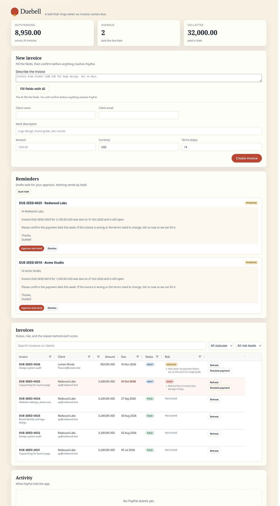

# Duebell

Duebell is a bell that rings when an invoice comes due.

It is an invoice-to-cash agent for freelancers and small businesses. You describe a job in plain English. Duebell creates and sends a PayPal sandbox invoice, scores how likely the client is to pay late, and drafts a reminder in the right tone. You approve the reminder before PayPal sends it. When the client pays, a webhook or a refresh closes the loop, and the payment feeds the next score.

This repository is a hackathon entry for the PayPal AI Hackathon. It runs in mock mode by default, so it works with no credentials.



## Status

Hackathon entry for the PayPal AI Hackathon, November 2026. The full flow runs in mock mode. The sandbox adapter is wired but needs your PayPal app to have the Invoicing scope.

## Quick start

```bash
python3 -m venv .venv
.venv/bin/pip install -r requirements.txt
cp .env.example .env
.venv/bin/python scripts/reset_demo.py
.venv/bin/uvicorn app.web:app --reload
```

Open http://127.0.0.1:8000.

## Demo flow

1. Type a sentence such as `Invoice Acme Studio, billing@acme.test, 1200 USD for logo design, net 2 days.`
2. Click `Fill fields with AI`, check the fields, then click `Create invoice`.
3. Read the risk badge and its reasons.
4. Click `Scan now`. Read the pending reminder.
5. Click `Approve and send`.
6. Click `Simulate payment`. The status and activity feed update.

The seed script creates six clients with different payment habits, so the risk levels have something to work with. Seeded invoices never reached PayPal, so the scan drafts reminders only for invoices you create. Net 2 days puts the new invoice inside the reminder window.

Step 2 works out of the box for the canonical sentence through the narrow mock parser. For free-form text, set `LLM_MODE=live` and a model endpoint. The manual form always works.

## Modes

- `PAYPAL_MODE=mock` uses an in-memory PayPal adapter.
- `PAYPAL_MODE=sandbox` calls the PayPal sandbox REST API.
- `PAYPAL_MODE=toolkit` sends, reminds, records payments and reads status through PayPal's Agent Toolkit. Creating invoices and verifying webhooks stay on the REST path, because the toolkit cannot set payment terms and has no webhook check. Install it with `pip install -r requirements-toolkit.txt --no-deps`. The live check is pending while the sandbox Invoicing scope returns 403. See ADR 0006.
- `LLM_MODE=mock` uses a narrow parser for the demo sentence and refuses anything else. The manual form and the reminder draft writer still work.
- `LLM_MODE=live` calls an Anthropic-compatible endpoint.
- `EMAIL_MODE=mock` keeps reminder emails in memory. `EMAIL_MODE=smtp` sends them through `SMTP_HOST`, `SMTP_PORT`, `SMTP_USERNAME`, `SMTP_PASSWORD` and `SMTP_FROM`. When approving a reminder, pick PayPal, email, or both.

## Evals

The reminder and webhook evals run offline. The parse eval needs a live model.

```bash
.venv/bin/python scripts/evals.py
LLM_MODE=live .venv/bin/python scripts/evals.py
```

Latest live run on 3 November 2026: parse 10 of 10 cases exact with 50 of 50 fields correct, reminders 10 of 10, webhook pass. Overall pass.

## Resilience

PayPal and model calls retry timeouts, transport errors, HTTP 429, and HTTP 5xx up to three times with exponential backoff. A final failure returns a clear error instead of leaving the UI spinning. Buttons show a working state, and failures appear in a banner.

The smoke script runs three clean reset-to-demo cycles. Each cycle reseeds six clients and 26 invoices, scans for reminders, and confirms that every draft is pending and nothing was sent.

```bash
.venv/bin/python scripts/smoke.py
```

## Deploy

`render.yaml` describes a small Render web service. It runs in mock mode, so the public demo needs no PayPal or model credentials. SQLite is ephemeral on the free plan; the demo reseeds on each deploy. Because the app has no login, treat a hosted instance as a demo only.

## Security and limits

Duebell is a single-user sandbox demo. It has no login, so do not expose it on the public internet.

- PayPal webhook signatures are verified before any state changes.
- Events are deduplicated by PayPal event id.
- Inputs are length-limited, amounts are capped, and currencies are allowlisted. Set `ALLOWED_CURRENCIES=USD,EUR` to invoice in more than one. Risk compares amounts only within a currency, and totals show one figure per currency.
- Webhook payloads are capped at 1 MB.
- Security headers and a content security policy are set on every response.
- Secrets live in `.env`, which is ignored by git. `.env.example` lists the names.

## Synthetic data

The risk model trains on synthetic client histories. Duebell ships an explainable rule baseline, and a logistic-regression script compares its held-out result beside the baseline. The comparison is a demonstration, not a claim about real clients.

The app also refits the comparison on its own history every six hours, or when you click `Refit now`. It uses only invoices with a known outcome (paid, or unpaid past due), and computes each one's features from the client's earlier invoices as of its issue date. Below 30 such invoices, or fewer than 5 late or 5 on time, the dashboard says there is not enough history instead of showing a number. The seeded demo sits below that line on purpose. The rule baseline stays the shipped score either way.

```bash
.venv/bin/python scripts/train_risk.py
```

## Sandbox setup

Set `PAYPAL_MODE=sandbox`, `PAYPAL_CLIENT_ID`, `PAYPAL_CLIENT_SECRET`, and `PAYPAL_INVOICER_EMAIL` in `.env`. The PayPal app needs the Invoicing scope.

PayPal webhooks need a public HTTPS URL. Expose the app with a tunnel, then register the hook:

```bash
.venv/bin/python scripts/register_webhook.py --url https://your-tunnel.example/webhooks/paypal
```

Put the printed id in `PAYPAL_WEBHOOK_ID`. The mock gateway needs none of this.

## Tests

```bash
.venv/bin/pytest -q
```

## Documentation

- `GLOSSARY.md`: domain terms.
- `docs/adr/`: design decisions.
- `docs/architecture.md`: how the pieces fit.
- `docs/submission.md`: hackathon submission notes.
- `docs/demo-script.md`: the recording plan.

## License

MIT. See `LICENSE`.
